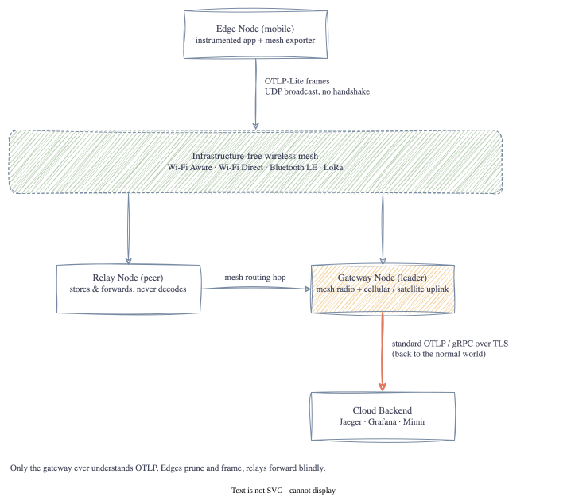

# OTLP-Lite-Mesh

> *Carrying OpenTelemetry over radios that were never meant to carry it*

[](https://jakesky45.github.io/otlp-lite-mesh/)
[](https://github.com/jakesky45/otlp-lite-mesh/actions/workflows/ci.yml)
[](https://go.dev)
[](LICENSE)

A learning project implementing the **OTLP-Lite-Mesh** protocol ([SPEC.md](SPEC.md)) in Go: a
24-byte binary header wrapping pruned OpenTelemetry protobuf payloads, sent over UDP multicast with no
handshake, and a gateway that re-hydrates frames into standard OTLP/gRPC for Jaeger or Grafana.

Built one stage at a time, with a blog post per stage explaining what each layer does and why.

## What It Does

```
edge app ──(OTel SDK)──▶ prune ──▶ compress? ──▶ 24-byte frame ──▶ UDP :4319
                                                                      │
Jaeger UI ◀── OTLP/gRPC ◀── hydrate Resource + Span ◀── validate ◀────┘  (gateway)
```

## Architecture



## Quick Start

```bash
make test        # go vet + go test -race
```

End-to-end demo targets (`make run-jaeger`, `make run-gw`, `make run-edge`) arrive with Stage 7.

## Repository Layout

| Path | Stage | Purpose |
| :-- | :-- | :-- |
| `pkg/frame` | 1 | 24-byte header encode/decode and validation |
| `pkg/payload` | 2 | OTLP protobuf helpers and size measurement |
| `pkg/prune` | 3 | Span and metric pruning rules (§4) |
| `pkg/compress` | 4 | gzip/zstd behind the Flags bits |
| `pkg/seal` | 5 | Mandatory AEAD sealing of frames (errata E7) |
| `pkg/transport/udp` | 6 | Profile Alpha: UDP multicast on 4319 |
| `pkg/gateway` | 7 | Frame → OTLP export request → gRPC upstream (§6) |
| `pkg/exporter` | 8 | OTel SDK `SpanExporter` that emits mesh frames |
| `cmd/` | 1–8 | `meshdump`, `meshgw`, `meshedge` binaries |
| `docs/` | all | Jekyll site with the blog posts |

## Documentation

All posts are at **[jakesky45.github.io/otlp-lite-mesh](https://jakesky45.github.io/otlp-lite-mesh/)**.

## License

MIT
