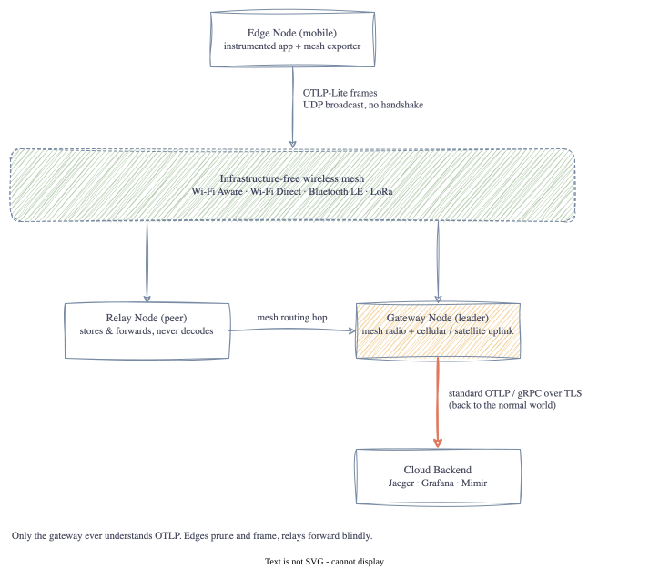

# Carrying OpenTelemetry Over a Radio Mesh

> *"The best telemetry is the telemetry that actually arrives."*

<!-- TODO(jake): your own intro – why this caught your interest after Robotinc -->

This project is a learning exercise. I'm taking a protocol spec, **OTLP-Lite-Mesh**, and building it
from the bytes up in Go: a 24-byte binary header, OpenTelemetry protobuf payloads squeezed to fit a
radio frame, UDP multicast with no handshake, and a gateway that turns it all back into normal
OTLP/gRPC so Jaeger or Grafana can show the traces.

**The Goal**: Understand what actually goes over the wire when an app sends a trace, and what you have
to throw away when the wire is a LoRa radio with 256 bytes per frame instead of a data centre network.
And learn Go properly along the way: every post ends with a **Go corner** on what the language taught me.

## How It Works

Edge nodes encode and broadcast tiny frames. Relay nodes forward them without looking inside.
A gateway node with an internet uplink unpacks them, re-hydrates full OTLP requests and ships them to
the cloud.

## What You'll Need

- **Go 1.27+**: everything is plain Go, no protoc or Docker required
- **A Mac or Linux box**: the demo runs entirely on loopback
- **Jaeger v2 binary**: downloaded by `make run-jaeger` for the end-to-end stage
- **Basic Command Line**: some bash/terminal knowledge

## Blog Posts

- [Part 1: Why OTLP Over a Mesh?](posts/01-why-otlp-over-a-mesh.html)
- [Part 2: Anatomy of a 24-Byte Header](posts/02-anatomy-of-a-24-byte-header.html)
- [Part 3: What's Actually Inside an OTLP Span](posts/03-whats-inside-an-otlp-span.html)
- [Part 4: Fitting a Span in 256 Bytes](posts/04-fitting-a-span-in-256-bytes.html)
- [Part 5: When Compression Makes Things Bigger](posts/05-when-compression-makes-things-bigger.html)
- Part 6: No TLS, So What Instead? Sealing the Frame *(coming soon)*
- Part 7: No Handshake: UDP Multicast on 4319 *(coming soon)*
- Part 8: Hydrating Back Into OTLP and gRPC *(coming soon)*
- Part 9: Watching a Trace Cross the Mesh *(coming soon)*
- Part 10: What the Spec Got Wrong, and What's Next *(coming soon)*

## Code

[GitHub Repository](https://github.com/jakesky45/otlp-lite-mesh) · [The Spec](https://github.com/jakesky45/otlp-lite-mesh/blob/main/SPEC.md)
