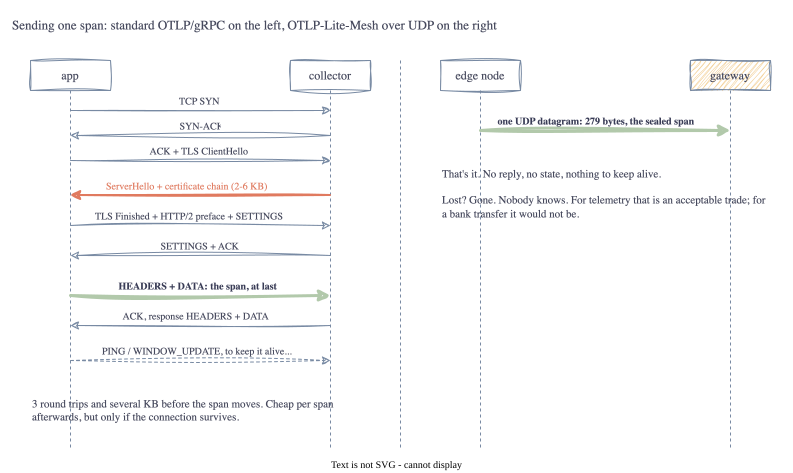
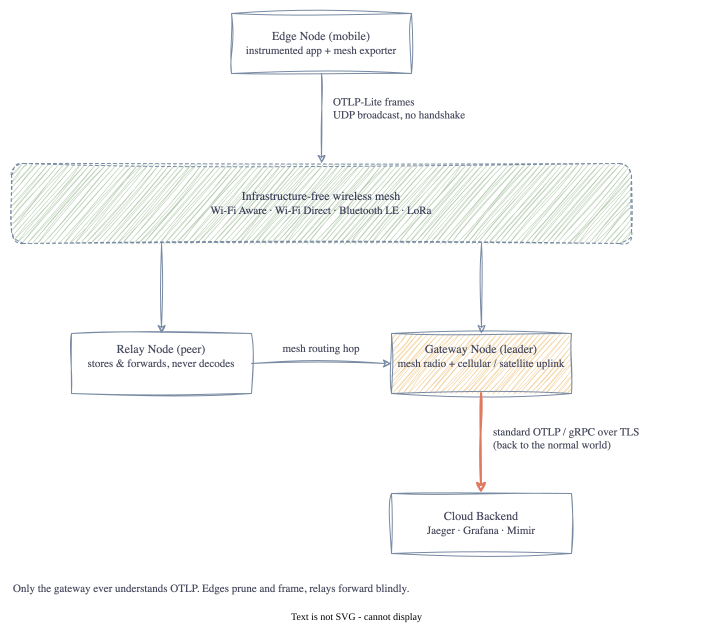

# Part 1: Why OTLP Over a Mesh?

<!-- TODO(jake): opening in your own words. Where did you first come across this idea? -->

OpenTelemetry has become the standard way to get traces, metrics and logs out of an application. But
every setup I've seen assumes the app can reach a collector over a proper network. What happens in an
environment with no internet at all? No Wi-Fi, no mobile signal, no collector to send to. Just other
devices within radio range. Can we still make use of OpenTelemetry, or does the whole idea fall over the
moment the network does?

I came across a spec called **OTLP-Lite-Mesh** that claims to answer that. I don't know yet whether it
is a good answer. The plan is to build it from the bytes up and find out, one lesson at a time.

Fair warning: the honest outcome of this series might be "not yet". Squeezing a trace, plus the
security it needs, into a couple of hundred bytes over a radio that lets you talk for 36 seconds an hour
may simply not work with today's tools. I'd rather try and write down where it breaks than assume.

I'm also using this as an excuse to properly learn Go. I've read Go, I've tweaked Go, but I've never
built something from an empty `go.mod`. Each post will have a short **Go corner** at the end covering
whatever the language made me learn that week. Expect beginner questions.

## New to any of this? Start here

I'm not going to explain OpenTelemetry or radio from scratch, but these are the pages I'd read first if
the terms are new. None of them are deep, and that's the point.

- **OpenTelemetry**: the open standard for getting traces, metrics and logs out of software.
  [What is OpenTelemetry?](https://opentelemetry.io/docs/what-is-opentelemetry/)
- **OTLP**: the protocol OpenTelemetry uses to send that data over the network.
  [OTLP specification overview](https://opentelemetry.io/docs/specs/otlp/)
- **LoRa**: a long range, very low bandwidth radio used by battery powered sensors. Kilometres of
  range, but only a couple of hundred bytes per message and strict limits on how often you can send.
  [What are LoRa and LoRaWAN?](https://www.thethingsnetwork.org/docs/lorawan/what-is-lorawan/)
- **Bluetooth LE**: the low energy flavour of Bluetooth, short range, tiny packets.
  [Bluetooth technology overview](https://www.bluetooth.com/learn-about-bluetooth/tech-overview/)
- **Wi-Fi Aware / Wi-Fi Direct**: ways for devices to talk Wi-Fi to each other with no router.
  [Wi-Fi Aware](https://www.wi-fi.org/discover-wi-fi/wi-fi-aware)

The common thread: these radios all work without any infrastructure, and they all make you pay for
every byte.

## Lesson 1: OpenTelemetry assumes a nice network

I had used OpenTelemetry for a while without ever thinking about what it does on the wire. It turns out
**OTLP**, the protocol, comes in two flavours:

- **OTLP/gRPC** on port 4317 - HTTP/2 over TCP, normally with TLS
- **OTLP/HTTP** on port 4318 - protobuf (or JSON) in an HTTP POST, over TCP, normally with TLS

Both of those were designed for data centres. Before a single span moves, there is a surprising amount
of chat:

1. A TCP three-way handshake (one round trip)
2. A TLS handshake (one or two more round trips). The server also sends its certificate chain so the
   client can check who it is talking to: its own certificate plus one or two intermediate CA
   certificates, each roughly 1 to 2 kilobytes. Call it 2 to 6 KB before any real data moves.
3. The HTTP/2 connection preface and settings frames
4. HTTP headers on every request, and keepalive pings to hold the connection open

On a wired network none of this matters. I had honestly never counted it before.

## Lesson 2: Radios make every byte expensive

Infrastructure-free meshes (Wi-Fi Aware, Wi-Fi Direct, Bluetooth LE, LoRa) all share a few traits that
fight the list above:

| | Data centre | Radio mesh |
| :-- | :-- | :-- |
| Airtime | effectively free | the scarce thing. Every byte costs battery and blocks neighbours |
| Frame size | 1500 B or more | LoRa about 256 B, BLE 27 to 251 B, IPv6 minimum 1280 B |
| Connectivity | always on | peers come and go. A "connection" may not outlive its own handshake |
| Delivery | reliable (TCP) | best effort. Retransmits burn the airtime you were trying to save |

The one that surprised me most was the airtime limit. LoRa runs on shared, licence-free radio bands, so
regulators cap how much of the time any one device may transmit (a "duty cycle"). In Europe it is 1%:
about 36 seconds of transmitting per hour, and after each message the radio has to stay quiet for 99
times as long as the message took. A LoRa message carries at most a couple of hundred bytes and takes a
second or two of airtime, so that is roughly 20 to 30 messages an hour. A TLS certificate chain of a few
KB would eat most of that hour's allowance before any telemetry moved.

Normally a span leaves an app wrapped in layers: inside gRPC, inside HTTP/2, inside TLS, inside TCP.
Each layer adds bytes and needs its own back-and-forth before any data can move. There are gentler ways
to slim that down. You could keep TCP and drop the rest, or use one of the protocols built for small
devices on bad networks (CoAP and MQTT-SN both exist for exactly this). The spec skips all of them and
goes straight to the simplest packet there is, a **UDP datagram**, with a **24-byte header** of its own
on the front saying what the payload is and which device it came from. You send it and that's it. Nobody
agrees to talk first (no handshake), there is no ongoing session to keep alive (no connection), and
nobody tells you whether it arrived (no acknowledgement).

Does that still work? The bytes will arrive, yes. UDP is how DNS lookups and video calls move data, and
it suits radios perfectly: send a packet, forget about it. What stops working is everything those layers
were quietly doing for you. Lost packets stay lost. Nothing is encrypted. And no normal OpenTelemetry
collector has any idea what these frames are. That last one is why the spec needs a gateway: something
at the far end has to turn the frames back into ordinary OTLP before Jaeger or Grafana can show them.
Most of this series is about building that translator and seeing what survives the trip.

Of those losses, the dropped packets I can live with. Telemetry is best effort by nature and a missing
span is annoying, not fatal. The missing encryption I can't live with. Anyone with a radio in range can
read every span, nothing stops them injecting fake ones, and the spec says nothing about it at all. So
I'm adding a requirement of my own: every frame gets encrypted and authenticated, and a gateway drops
anything that isn't. It has to fit in the same byte budget as everything else, which makes it one of the
more interesting lessons later in the series.

## Lesson 3: Three roles, and only one of them understands OTLP

- **Edge node** - the instrumented device. It cuts each span down to the essentials (trace ID, span ID,
  parent, name, timing, three attributes at most), maybe compresses it, wraps it in the header and
  broadcasts it.
- **Relay node** - any peer in range. It forwards frames it hears without ever decoding the payload.
  The 24-byte header is all it needs. I like this: the relays can stay dumb.
- **Gateway node** - the one peer with a real uplink. It validates the frame, unpacks the payload,
  rebuilds a full OTLP request with the metadata that was stripped, and sends it on over ordinary
  OTLP/gRPC. Jaeger or Grafana never know the trace crossed a mesh.

One thing I'm deliberately leaving alone for now: what the cloud backend is. The gateway speaks plain
OTLP/gRPC, so it could be Jaeger on a laptop or a managed service in AWS. That's a pin for later. The
thing I want to learn here is the protocol, not the backend.

## The spec, and a confession

The spec, plus a growing list of the gaps I find in it, lives in
[SPEC.md](https://github.com/jakesky45/otlp-lite-mesh/blob/main/SPEC.md). Even before writing code I
had to add seven entries to the errata table, because the spec never says *which* protobuf message goes
in the payload, how big the payload is allowed to be, or what to do with the reserved bits. I suspect
that is normal and I'd just never implemented a spec before.

<!-- TODO(jake): anything you already disagree with in the spec? Flag it here and come back to it in
     the wrap-up. -->

## Go corner: starting from nothing

There is no code yet, so this one is short. A Go project starts with `go mod init <module path>`, which
writes a `go.mod` file naming the module (`github.com/jakesky45/otlp-lite-mesh`) and the Go version.
Every package I write lives in a folder under that path, and every import of it uses the full module path,
not a relative one. Coming from other languages that felt verbose; a week in it feels obvious, because
there is never any ambiguity about which package you mean.

The other thing I noticed: `go vet ./...` and `go test ./...` run with no setup at all. No test framework
to pick, no runner to install. The `./...` means "this directory and everything under it", and I'll be
typing it a lot.

<!-- TODO(jake): anything else that surprised you about Go setup? -->

## Next Steps

[Part 2: Anatomy of a 24-Byte Header →](02-anatomy-of-a-24-byte-header.html)
