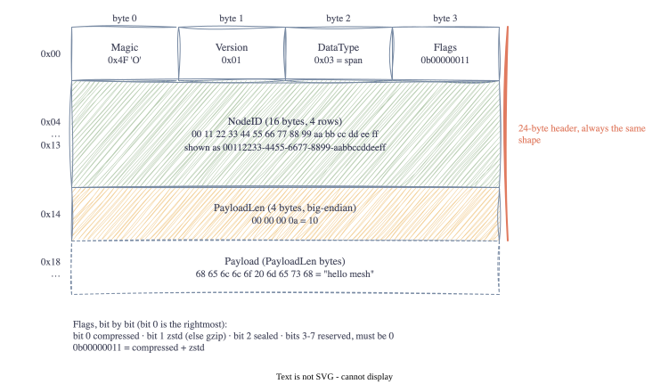

# Part 2: Anatomy of a 24-Byte Header

<!-- TODO(jake): opening in your own words. Had you ever written a binary protocol before this? -->

Time to write some bytes. Before any OpenTelemetry gets involved, the spec defines a 24-byte header
that goes on the front of every frame, and that header is the only thing a relay node ever looks at. So
it is the natural place to start, and small enough that I could hold the whole thing in my head.

Here it is, with the sample frame that the `meshdump` tool generates:



## Lesson 1: Why a fixed header at all?

My first instinct was that 24 bytes is a lot of overhead when the payload might only be 100 bytes.
Protocols like protobuf and MQTT use variable-length encodings to save space, so why not here?

The answer is the relay node. A relay forwards frames it did not create and must not decode. With a
fixed layout, it can read the data type at byte 2 and the sender at bytes 4 to 19 without parsing
anything. No state, no loops, no "read a length, then read that many bytes". On a device with a few KB
of RAM, that simplicity matters more than saving a handful of bytes. The 24 bytes are also mostly the
16-byte NodeID, and I can't see a way to shrink that without losing the "which device sent this" promise.

<!-- TODO(jake): do you buy this argument? It's the spec's reasoning; I'm about 80% convinced. -->

## Lesson 2: Byte order, or why 10 is `00 00 00 0a`

`PayloadLen` is a 4-byte integer. The number 10 shows up in the dump as `00 00 00 0a`, with the big
end first. That is **big-endian**, also called network byte order, and the spec requires it for every
multi-byte number.

Your laptop almost certainly stores that same number the other way round in memory, `0a 00 00 00`, which
is **little-endian**. Neither is better; the point is that both ends of the wire have to agree, and the
convention for network protocols since the 1980s is big-endian. If I had written the length with my
machine's native order and a device with a different CPU received it, 10 would have read as 167,772,160
and the receiver would have waited for 160 MB that was never coming.

## Lesson 3: Validation order, and what "buffer poisoning" means

Section 6 of the spec is a checklist for the receiver, and the order turned out to matter:

1. Is there even a header's worth of data? (24 bytes)
2. Is byte 0 the magic `0x4F`? If not, drop it. Don't read any further.
3. Is the version one we understand?
4. Is the data type one of the three we know?
5. Are the flag bits legal?
6. Is `PayloadLen` within our limit?
7. Does the actual data length equal `24 + PayloadLen`?

The cheapest checks come first, so junk is thrown away with the least work. The magic byte is a nice
trick: a radio shares the air with other protocols, and a single byte comparison filters most of them.

Step 6 is one the spec forgot. The spec says to check `24 + PayloadLen` matches what arrived, but
nothing stops a hostile frame claiming a 4 GB payload. A naive receiver that allocated a buffer of that
size on trust would fall over. That is what the spec's phrase "buffer poisoning" means. So the decoder
takes a limit (1256 bytes by default, keeping the whole frame under the 1280-byte IPv6 minimum) and
rejects anything bigger before touching the payload. I added this to the errata as E2.

## Lesson 4: Flags are bits, not bytes

The flags byte `0b00000011` packs several yes/no answers into one byte. Bit 0 says the payload is
compressed, bit 1 says it is zstd rather than gzip, and I've claimed bit 2 for "sealed" (that's the
encryption from Part 6). Bits 3 to 7 are reserved.

Two rules the spec implies but does not state, now written down as errata E3:

- Bit 1 (zstd) means nothing on its own. A frame with zstd set but compressed clear is rejected.
- Reserved bits **must be zero**, and a receiver rejects frames that set them.

That second rule felt harsh until I thought it through. If today's receivers ignore reserved bits, then
tomorrow's spec cannot give those bits a meaning, because old receivers would silently misread new
frames. Rejecting them now is what keeps the door open later.

## Seeing it

The `meshdump` tool prints a frame field by field. Piping a generated sample into it:

```
$ go run ./cmd/meshdump -demo | go run ./cmd/meshdump
34 bytes total

offset  bytes                                             field
0x00    4f                                                Magic      'O' ok
0x01    01                                                Version    1
0x02    03                                                DataType   span
0x03    03                                                Flags      0b00000011 compressed|zstd
0x04    00 11 22 33 44 55 66 77 88 99 aa bb cc dd ee ff   NodeID     00112233-4455-6677-8899-aabbccddeeff
0x14    00 00 00 0a                                       PayloadLen 10 (have 10)

payload (10 bytes):
00000000  68 65 6c 6c 6f 20 6d 65  73 68                    |hello mesh|
```

And the same frame with its first byte changed from `O` to `X`:

```
$ go run ./cmd/meshdump -demo | LC_ALL=C sed 's/^O/X/' | go run ./cmd/meshdump
34 bytes total

offset  bytes                                             field
0x00    58                                                Magic      0x58, expected 0x4f
0x01    01                                                Version    1
...
INVALID: frame: bad magic byte: 0x58
```

(The `LC_ALL=C` is there because macOS `sed` refuses to touch bytes that are not valid text, and most of
a frame is not text.)

<!-- TODO(jake): try chopping bytes off the end with `head -c 30` too; the length check catches it.
     Which of the checks surprised you? -->

## Testing it

The code is in [`pkg/frame`](https://github.com/jakesky45/otlp-lite-mesh/tree/main/pkg/frame). Three
kinds of tests:

- **Golden bytes.** I typed the sample frame out by hand as hex from the spec table, then checked that
  `Encode` produces exactly those bytes and `Decode` reads them back. If I had generated the expected
  bytes with `Encode` itself, the test would only prove the encoder agrees with itself.
- **A table of broken frames.** Bad magic, wrong version, each reserved bit, a length that lies, a
  4 GB `PayloadLen`. Each one must produce the specific error I expect.
- **Fuzzing.** `go test -fuzz` throws random bytes at `Decode` for 30 seconds. It must never panic, and
  anything it accepts must encode back to the identical bytes. It found nothing, which was slightly
  disappointing and mostly reassuring.

## Go corner

Things Go made me learn this time:

- **`encoding/binary`.** `binary.BigEndian.PutUint32(buf[20:24], n)` writes a 4-byte big-endian
  integer; `binary.BigEndian.Uint32(buf[20:24])` reads it. Spelling out `BigEndian` every time is the
  language refusing to let you forget Lesson 2.
- **Arrays versus slices.** `NodeID` is `[16]byte`, an array, not `[]byte`, a slice. An array has a
  fixed size baked into its type, is copied by value, and can be compared with `==`. A slice is a view
  onto some other memory. The ID is always exactly 16 bytes, so the array is the honest type, and it
  means a whole `Header` can be compared with `==` in tests.
- **Sentinel errors and `%w`.** `var ErrBadMagic = errors.New(...)` defines an error value callers can
  recognise. The decoder returns `fmt.Errorf("%w: 0x%02x", ErrBadMagic, b[0])` so the message carries
  detail, and callers check with `errors.Is(err, frame.ErrBadMagic)` instead of comparing strings.
- **Table-driven tests.** A slice of structs, one per case, and a loop that calls `t.Run(name, ...)` for
  each. Adding a case is one line. It's the idiom you see in every Go codebase and now I know why.
- **`go test -fuzz`.** Built into the toolchain, no extra library. You give it a few seed inputs and a
  function that must not panic, and it mutates the seeds looking for one that does.
- **`bytes.Clone`.** `Decode` returns a copy of the payload rather than a slice pointing into the input.
  Slightly slower, but it means a caller can reuse its receive buffer straight away without the decoded
  frame changing under it. There's a test for exactly that.

<!-- TODO(jake): which of these was new to you? Cut the ones that weren't. -->

## Next Steps

The header is the easy part. Next: what actually goes in the payload, and how big an OpenTelemetry span
really is when you look at it as bytes.

[Part 3: What's Actually Inside an OTLP Span →](03-whats-inside-an-otlp-span.html)
