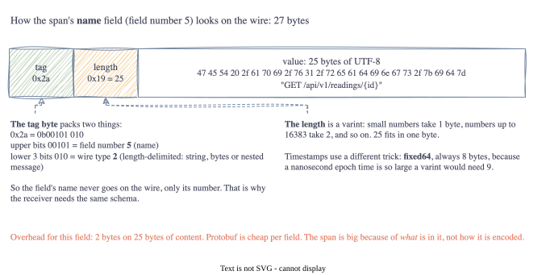

# Part 3: What's Actually Inside an OTLP Span

<!-- TODO(jake): opening in your own words. Had you ever looked at a span as bytes before? -->

The header from Part 2 says "a span follows". Now I want to know what a span actually is when it is
bytes rather than a nice tree in the Jaeger UI. Because if the budget is a couple of hundred bytes, I
need to know what I'm cutting before I cut it.

## Lesson 1: Protobuf in one diagram

OTLP uses Protocol Buffers for the payload. I'd used protobuf before without thinking about the bytes,
and it turns out the encoding is simple enough to read by hand. Every field is written as a **tag**, then
either a value or a length and a value:



Three things I didn't appreciate until I decoded one myself:

- **Only the field number goes on the wire, never the name.** `name` is field 5, so the receiver
  needs the same schema to know that 5 means "name". That is why renaming a field is free in protobuf
  but renumbering one breaks every existing reader.
- **Small numbers are small.** The length 25 is one byte. The enum `kind = 2` is one byte. A
  **varint** uses as many bytes as the number needs, seven bits at a time.
- **Big numbers are fixed.** The two timestamps are nanoseconds since 1970, about 1.7 × 10¹⁸, which
  would need nine bytes as a varint. So the schema marks them `fixed64` and they always take eight.

Per field, the overhead is one or two bytes. Protobuf is not the problem.

## Lesson 2: Where 1090 bytes go

I built a sample span the way a real SDK would emit one: a failed HTTP request on a field device, with
the W3C example trace IDs, a trace state, nine attributes following the OpenTelemetry semantic
conventions, an exception event with a stack trace, and an error status. Then I wrote a small function
that walks the bytes and adds up the cost of each field:

```
$ go test ./pkg/payload -run Example -v
  #  field                  wire     count  bytes
  1  trace_id               bytes        1     18
  2  span_id                bytes        1     10
  3  trace_state            bytes        1     41
  4  parent_span_id         bytes        1     10
  5  name                   bytes        1     27
  6  kind                   varint       1      2
  7  start_time_unix_nano   fixed64      1      9
  8  end_time_unix_nano     fixed64      1      9
  9  attributes             bytes        9    493
 11  events                 bytes        2    449
 15  status                 bytes        1     22
                                    total   1090
```

So one ordinary span is **1090 bytes**. That is already bigger than a LoRa frame by a factor of four,
and it has not been wrapped in anything yet.

Look at where the weight is:

| Group | Bytes | Share |
| :-- | --: | --: |
| Identity and timing (IDs, name, kind, start, end, status) | 107 | 10% |
| Trace state | 41 | 4% |
| Attributes (9 of them) | 493 | 45% |
| Events (exception with stack trace, retry) | 449 | 41% |

The part that makes a span a span, the bit you cannot lose without breaking the trace graph, is about
**107 bytes**. Everything else is context. Useful context, but context. The `user_agent.original`
attribute on its own is 140 bytes, more than all the IDs and timestamps put together. The
`error.message` attribute is 134. The stack trace inside the exception event is 280.

<!-- TODO(jake): this is where I'd put your reaction. Did the 10% surprise you? -->

## Lesson 3: What's not in the frame at all

A normal OTLP export doesn't send a bare span. It sends a `ResourceSpans` containing a `Resource`
(which service, which host, which SDK version, often 10 to 20 attributes), containing a `ScopeSpans`
(which instrumentation library), containing the spans. Those wrappers are the same for every span a
device ever sends, and they can easily be another 200 to 400 bytes.

The spec never actually says which of these goes in the payload. I've decided (errata E1) that a frame
carries **exactly one bare `Span`**, and nothing else. The 16-byte NodeID in the header already says
which device sent it, so the gateway can rebuild the `Resource` from that when it reconstructs a proper
OTLP request. Same for metrics (one `Metric`) and logs (one `LogRecord`).

That decision is what makes the 24-byte header earn its keep: it replaces a few hundred bytes of
protobuf wrapping with 24 bytes of fixed layout.

## What the code does

[`pkg/payload`](https://github.com/jakesky45/otlp-lite-mesh/tree/main/pkg/payload) is small:

- `Marshal(msg)` serialises a span, metric or log record and tells you which `DataType` the frame needs.
  Anything else is rejected.
- `Unmarshal(dataType, bytes)` does the reverse.
- `Describe(bytes, schema)` produces the table above by walking the raw wire format.
- `SampleSpan()` is the 1090-byte span. It is deterministic on purpose: the next two parts prune and
  compress it, and I want the before and after numbers to be reproducible.

I did not run `protoc` or generate any code. The OpenTelemetry project publishes the generated Go types
as a module (`go.opentelemetry.io/proto/otlp`), so one `go get` was the whole setup.

## Go corner

<!-- TODO(jake): keep or cut; the Go teaching happens in conversation, this is just notes -->

- **Modules and `go.sum`.** `go get` added the dependency to `go.mod` and wrote its hashes to
  `go.sum`. Every later build checks the download against those hashes.
- **Struct tags.** The backticked strings on generated struct fields, like `protobuf:"bytes,5,..."`, are
  metadata the protobuf library reads at runtime to know field numbers and wire types.
- **Type switch.** `switch m.(type) { case *tracepb.Span: ... }` branches on the concrete type behind an
  interface. It's how `Marshal` picks the `DataType`.
- **Type assertion.** `span, ok := m.(*tracepb.Span)` is the single-type version: "I believe this
  interface holds a `*Span`, give it to me, and tell me if I'm wrong."
- **`proto.Equal`, not `==`.** The generated structs hold pointers and internal state, so `==` would
  compare addresses. The library's `Equal` compares content.
- **External test packages.** The tests are `package payload_test`, so they can only use the exported
  API, like any real caller would.
- **Example tests.** `func ExampleDescribe()` with an `// Output:` comment is run by `go test` and the
  printed text must match. The table in this post *is* the test.

## Next Steps

Now I know what to cut. Part 4 is the pruning rules from the spec: which fields are sacred, which three
attributes survive, and whether 1090 bytes can really become fewer than 256.

[Part 4: Fitting a Span in 256 Bytes →](04-fitting-a-span-in-256-bytes.html)
