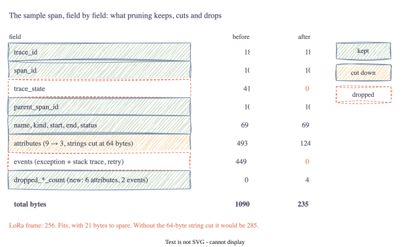

# Part 4: Fitting a Span in 256 Bytes

<!-- TODO(jake): opening in your own words. Did you expect it to fit? -->

Part 3 ended with a 1090-byte span and a 256-byte radio frame. This part is the spec's answer to that
gap, section 4, which it calls "payload pruning". I wasn't sure going in whether the rules would be
enough. They are, just, and the margin taught me more than the rules did.

## Lesson 1: What is sacred

The spec is clear on one thing: the **trace ID, span ID and parent span ID must not be touched**.
Everything else is negotiable. The reason is the trace graph. A trace is just a set of spans that share
a trace ID, each pointing at its parent. Change one byte of an ID and the span becomes an orphan in the
backend, or worse, attaches to someone else's trace.

I also kept the name, the kind (server, client, internal and so on), the two timestamps and the status.
Without those a span is a line with no label. Together with the IDs, that core is **111 bytes**.



## Lesson 2: What goes

Three things are dropped outright:

- **Trace state** (41 bytes in the sample). This is vendor-specific context that rides along with the
  trace ID, and the spec says drop it. I have mixed feelings, because it is part of W3C trace context,
  but nothing in the graph breaks without it.
- **Events** (449 bytes). The exception event with its stack trace was 41% of the whole span. Painful to
  lose, but a stack trace is a terrible thing to send over a radio and the status already says "error".
- **Links** (none in the sample). References to other traces. Same argument as events.

Rather than silently vanish, each of these increments a counter OTLP already has for the purpose:
`dropped_events_count`, `dropped_links_count`, `dropped_attributes_count`. They cost two bytes each and
mean the backend can show "2 events were dropped" instead of pretending there were none. The spec does
not mention this; I think it should.

## Lesson 3: Three attributes, and a rule that turned out to matter

The spec allows **at most three attributes** and suggests which: `error.message`, `sys.battery` and
`sys.latency`. I implemented that as an allow-list in priority order, so a span with all nine of the
sample's attributes keeps exactly those three and drops the other six.

Then the surprise. The spec also says `error.message` is "truncated to maximum 64 characters", which I
had read as a detail. The sample's error message is 110 characters. Here is what the pruned span weighs
with and without that rule:

| | Bytes |
| :-- | --: |
| Core span, no attributes | 111 |
| Core plus three attributes, untruncated | 285 |
| Core plus three attributes, strings cut at 64 | **235** |
| LoRa frame | 256 |

Without truncation the span does not fit. With it there are 21 bytes to spare. The rule I'd skimmed is
the difference between the spec working and not working, and that is before the 24-byte header, before
the 20 bytes the sealing step will add, and before compression gets a say.

<!-- TODO(jake): 235 + 24 header + 20 sealing = 279. Already over 256. Worth saying out loud here or
     saving for the compression post? Your call. -->

Here is the before and after, printed by a test so it cannot drift from the code:

```
before: 1090 bytes, 9 attributes, 2 events, trace state 39 bytes
after:   235 bytes, 3 attributes, 0 events, trace state 0 bytes
dropped: 6 attributes, 2 events, 0 links
  kept error.message = dial tcp 10.42.0.9:5432: i/o timeout after 10s while fetching re
  kept sys.battery   = 83
  kept sys.latency   = 10412
```

That error message ends mid-word. Sixty-four bytes is sixty-four bytes.

## Lesson 4: Cutting a string is not as simple as it looks

"Truncate to 64 characters" hides a trap. In Go, and on the wire, a string is a sequence of **bytes**,
and characters outside ASCII take two to four bytes each in UTF-8. Cut at byte 64 and you can land in
the middle of a character, leaving a broken half-character at the end that some backends will reject
as invalid text.

The fix is to step backwards from the cut point until you reach the start of a character. There's a
test that fills a name with 40 copies of `é` (two bytes each) and checks the result is both 64 bytes
and valid UTF-8. The spec says "characters"; the implementation has to mean "bytes, at a character
boundary", because bytes are what the radio counts.

## Metrics, briefly

Section 4.2 of the spec allows only **Gauge** and **Sum** metrics, and forbids histograms, because a
histogram is a list of bucket boundaries and counts that can run to hundreds of bytes. I implemented
that as a hard error: hand the pruner a histogram and it refuses. For the allowed types it also strips
*exemplars* (each one carries a trace ID, a span ID and attributes) and the description string. A
sample battery gauge went from 257 bytes to 61.

## What the code does

[`pkg/prune`](https://github.com/jakesky45/otlp-lite-mesh/tree/main/pkg/prune) has a `Policy` (max
attributes, allow-list, string limit), a `Default` matching the spec, `Span(in, policy)` and
`Metric(in, policy)`. Both return a **new** message and leave the input alone, so an app could still
send the full span over Wi-Fi later if it gets the chance. A test writes into the pruned span's trace
ID and checks the original did not change; the first version of the code failed that test, which is
its own Go lesson below.

## Go corner

<!-- TODO(jake): keep or cut -->

- **Slices share memory.** `out.TraceId = in.TraceId` copies a small header (pointer, length,
  capacity), not the bytes. Both spans then point at the same 16 bytes, and changing one changes the
  other. `bytes.Clone` makes a real copy. A test caught this; I would not have.
- **`proto.Clone`** does the same for whole protobuf messages, deep copy included.
- **Oneof fields are interfaces.** A metric's `Data` is one of Gauge, Sum, Histogram and so on. In Go
  that is an interface field holding one of several wrapper types, and `switch d := in.Data.(type)`
  picks the branch. The forbidden types each get their own error message that way.
- **Maps for lookup.** Matching nine attributes against a three-key allow-list is a nested loop; putting
  the attributes in a `map[string]*KeyValue` first makes each lookup constant time. Trivial here, but
  it's the habit.
- **Methods on small values.** `Policy` is a plain struct and its helpers are methods with a value
  receiver, `func (p Policy) selectAttributes(...)`. No pointer needed; it is only read.
- **`unicode/utf8`.** `utf8.RuneStart(b)` says whether a byte begins a character. That one function is
  the whole truncation fix.

## Next Steps

235 bytes fits. 235 plus a 24-byte header plus 20 bytes of sealing does not. Part 5 asks whether
compression can claw that back, and finds out what gzip does to a payload this small.

[Part 5: When Compression Makes Things Bigger →](05-when-compression-makes-things-bigger.html)
