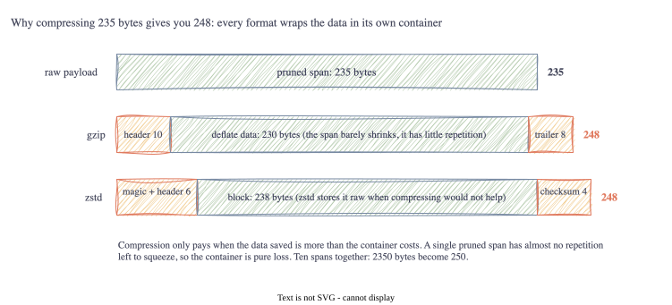

# Part 5: When Compression Makes Things Bigger

<!-- TODO(jake): opening in your own words. Did you assume compression always helps? I did. -->

Part 4 left us at 235 bytes for a pruned span, with a 24-byte header and 20 bytes of security still
to add. The spec has a compression flag, so the obvious next move is to switch it on and claw some
bytes back. I assumed this would be the easy part. It was the part where I learned that compression
is not free, and that on small payloads it can cost more than it saves.

## Lesson 1: Every compressed file is a container

The spec gives two options behind the flag bits: **gzip** (bit 0) and **zstd** (bits 0 and 1). Both
work the same way at the top level: they find repeated patterns in the data and replace them with
shorter references. But the output is not just the squeezed data. It is wrapped in a container with a
header saying what it is, and a trailer or checksum to detect corruption:



I measured the wrapping on its own by compressing an empty payload: **gzip adds 20 bytes, zstd adds
9**, before a single byte of real data. On a 10 MB file nobody notices. On a 235-byte span it is 4 to
10 percent of the budget, and it has to be paid back in savings before compression breaks even.

## Lesson 2: The pruned span does not compress

Here is the table, printed by a test so it stays honest:

```
payload            raw  gzip  zstd  auto picks
pruned span x1     235   248   248  none
pruned span x10   2350   270   250  zstd
raw span x1       1090   743   738  zstd
```

Read the first row twice. The 235-byte pruned span becomes **248 bytes** under either algorithm. We
would be spending airtime to send 13 bytes of nothing.

The reason is what pruning already did. Compression works on repetition, and the raw 1090-byte span
had plenty: the string `http.` five times, the error message twice, a stack trace full of
`at net/http`. The raw span compresses to 738 bytes, a third off. But pruning removed exactly that
material. What is left is sixteen bytes of trace ID, eight of span ID, two timestamps and one short
message, none of which repeats. zstd looked at it, found nothing to do, and stored it raw inside its
container. gzip found 12 bytes of savings and spent 25 on wrapping.

The second row shows what would make compression worth it: **batching**. Ten spans together go from
2350 bytes to 250, because the trace ID and the attribute keys repeat across them. But the spec sends
one span per frame, and a 250-byte zstd blob does not fit a 256-byte LoRa frame once the header is on.
So for Profile Alpha over UDP, batching is a real option (1280-byte frames); for LoRa it is not.

<!-- TODO(jake): your view: is one-span-per-frame the right call for the spec, or should it allow
     batching on transports with room? I lean towards allowing it. -->

## Lesson 3: Let the code decide

Since the answer depends on the payload, I did not hard-code a choice. `compress.Auto` tries zstd and
gzip, compares against the original, and keeps whichever is smallest, **including "leave it alone"**.
The flag bits then record what actually happened, so the gateway always knows how to undo it. For a
single pruned span the flags come out as zero, and the frame goes out uncompressed, which is the
right answer and the one the spec's optional flag was presumably there to allow.

## Lesson 4: Decompression is where the danger is

The spec's gateway pipeline says "if compression bits are flagged, stream the payload through a
decompression ring buffer". It does not say what happens if someone sends a frame that is 15 bytes on
the wire and 64 kilobytes when inflated. I tried it:

```
65536 bytes of zeros -> 97 bytes of gzip
65536 bytes of zeros -> 15 bytes of zstd
```

A 15-byte frame that expands 4000 times. Scale that up and a hostile radio could exhaust a gateway's
memory with a handful of packets. It is called a decompression bomb and it is an old trick. So
`compress.Decode` takes a size limit: for gzip it stops reading one byte past the limit and rejects;
for zstd it reads the declared size from the frame header and refuses before inflating anything. Both
bombs above are rejected with `ErrTooLarge` against the default 1256-byte limit. This goes in the
errata as a gap in section 6.

## Lesson 5: gzip is heavier than it looks

Benchmarks on the 235-byte span, on my laptop:

| | encode | decode | memory per encode |
| :-- | --: | --: | --: |
| gzip | 103 µs | 1.9 µs | 1.1 MB |
| zstd | 7 µs | 0.1 µs | 5.6 KB |

The time differences would not matter at a few spans a second. The **1.1 megabytes of allocation per
gzip call** might. gzip builds its compression tables from scratch every time; zstd reuses an encoder
built once at start-up. On a laptop that is noise. On a device with a few MB of RAM, allocating a
megabyte to compress 235 bytes, and then throwing it away, is a problem. If the spec kept only one
algorithm, zstd would be the one, and gzip's place in it is probably about familiarity.

## Where the budget stands

| | bytes |
| :-- | --: |
| Pruned span | 235 |
| Compression | 0 (Auto declines) |
| Frame header | 24 |
| Sealing (next part) | ~20 |
| **Total on the wire** | **~279** |
| LoRa frame | 256 |

So the honest position after five parts: a single secured span does **not** fit a LoRa frame with the
spec as written, by about 23 bytes. It fits comfortably in the 1280-byte IPv6 budget that the UDP
profile uses. That is not the answer I wanted, but it is the one the measurements give, and it is the
sort of thing a spec should say out loud.

<!-- TODO(jake): the "we can't yet" thread from Part 1 lands here for the first time. Worth a
     paragraph in your voice? -->

## Go corner

<!-- TODO(jake): keep or cut -->

- **`io.Reader` and `io.Writer`.** Go's two universal "stream of bytes" interfaces. `gzip.NewWriter`
  takes any `io.Writer`; I gave it a `bytes.Buffer`, but a file or a socket would work unchanged.
  Most of the standard library is built on these two.
- **`bytes.Buffer`.** An in-memory byte buffer that is both a Reader and a Writer. Its zero value is
  ready to use: `var buf bytes.Buffer` and go.
- **`Close` matters.** For a compressor, `Close` writes the final block and trailer. Forget it and the
  output is silently truncated. The test that round-trips every input would have caught it.
- **`defer`.** `defer r.Close()` runs when the function returns, by any path. It is Go's answer to
  `finally`, and the idiom for anything that must be cleaned up.
- **`io.LimitReader`.** Wraps a reader so it stops after N bytes. Asking for the limit plus one and
  checking whether you got it is the standard way to detect "too big" without reading it all.
- **`iota`.** The counter that makes `None, Gzip, Zstd` into 0, 1, 2 without writing the numbers.
- **Benchmarks.** `func BenchmarkX(b *testing.B)` with `for b.Loop()`; `go test -bench=. -benchmem`
  prints time and allocations per operation. The 1.1 MB finding came from `-benchmem`.
- **Package-level variables.** The shared zstd encoder is created once at start-up, before `main`,
  and reused by every call. That is why zstd allocates 5 KB per call and gzip allocates a megabyte.

## Next Steps

Compression gave us nothing on a single span, and we still have the security requirement from Part 1
to meet. Part 6 adds it: encrypting and authenticating every frame, for about 20 bytes, without a
handshake.

[Part 6: No TLS, So What Instead? Sealing the Frame →](06-sealing-the-frame.html)
