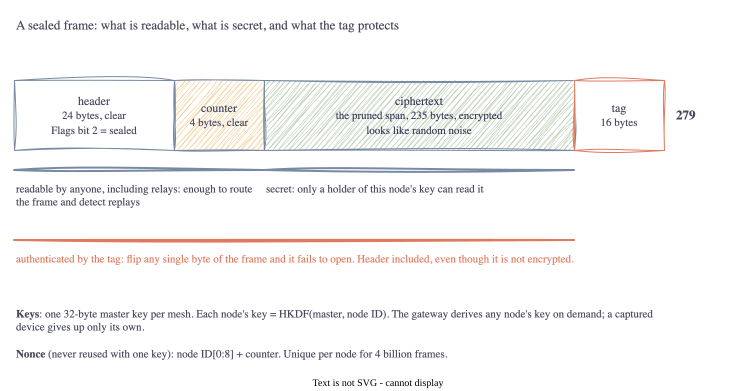

# Part 6: No TLS, So What Instead? Sealing the Frame

<!-- TODO(jake): opening in your own words. This is the part you said was non-negotiable. -->

Back in Part 1 I set one requirement of my own: every frame gets encrypted and authenticated, and a
gateway drops anything that isn't. The spec has nothing to say about it. This part is how I did it,
what it costs, and what it still doesn't cover. I'm not a cryptographer, so the approach is the boring
one: use the standard building blocks exactly as intended and compose them in the simplest way that
works.

## Lesson 1: What TLS was doing for us

When we threw TLS away in Part 1 we lost three things at once:

- **Confidentiality**: nobody in radio range can read the spans.
- **Integrity**: nobody can change a frame in flight without it being noticed.
- **Authenticity**: a frame claiming to come from node X really came from node X.

TLS gets those with a handshake, certificates and a session. We have no handshake and no session, so
each frame has to carry its own proof. The tool for that is **authenticated encryption**, or AEAD:
one operation that encrypts the data and produces a short *tag* that only someone with the key could
have made. Change one bit of the frame and the tag no longer matches. I used ChaCha20-Poly1305, which
is what TLS 1.3 itself uses on devices without hardware AES, and which costs a fixed **16 bytes** per
message.

## Lesson 2: Encrypt the payload, authenticate everything

Here is the choice that took the most thought. The header has to stay readable, because relay nodes
route on it without a key. But if the header is readable and *unprotected*, anyone can change the
NodeID or DataType on a frame as it passes.

AEAD has an answer built in: **associated data**. You hand the cipher some bytes that are *not*
encrypted but *are* covered by the tag. We pass the 24-byte header as associated data. Relays read it
freely; the gateway checks it. Flip one bit of the header and the frame fails to open.



There's a test for exactly that claim: it seals a frame, then flips every single byte in turn, all 54
of them, and checks that each flipped frame is rejected. Header, counter, ciphertext, tag. It passes,
which is the most reassuring green tick in the project so far.

## Lesson 3: Nonces, and why the counter is in clear

ChaCha20-Poly1305 needs a 12-byte *nonce* with each message, and the one rule is **never use the same
nonce twice with the same key**. Break that and the encryption is broken; it's not a theoretical
weakness, it's a well-known catastrophic one.

With no handshake there's nobody to agree a nonce with, so it has to be derived from things both ends
know. Ours is the first 8 bytes of the NodeID followed by a 4-byte counter that the node increments on
every frame. The counter travels in clear as the first 4 bytes of the sealed payload, so the gateway
can rebuild the nonce without any state about that node. 4 bytes means 4 billion frames per node per
key, and the sealer refuses to continue past that rather than wrap around; the key has to be rotated
first.

## Lesson 4: Replay, and the window

Authentication stops forgery. It does not stop someone recording a valid frame and sending it again an
hour later. The gateway would decrypt it fine; it's genuine, just old.

The counter solves this too, as long as the gateway remembers what it has seen. The naive rule, "reject
anything not greater than the last counter", breaks on UDP, which can deliver packets out of order. So
the gateway keeps, per node, the highest counter seen plus a 64-bit map of which of the previous 64
counters have arrived. A frame is accepted if its counter is new; a repeat is rejected; anything more
than 64 behind is rejected because we can no longer tell. This is the same scheme IPsec has used since
the nineties. The check runs *after* authentication, so a forged frame with a huge counter can't be
used to push the window forward and block the real node.

## Lesson 5: One master key, many node keys

Every node and the gateway share a 32-byte master key. But each node encrypts with its **own** key,
derived from the master and the NodeID with HKDF, a standard key-derivation function. The gateway
derives a node's key the first time it hears from it and caches it.

Why bother? Two reasons. If a device is captured, its key opens only its own traffic. And the nonce
rule above is per key: giving each node its own key means two nodes can't collide on a nonce even if
their IDs shared the first 8 bytes. Key *distribution* (how the master key gets onto a device in the
first place) is out of scope here and honestly the hard part; it's on the list for the wrap-up.

## What it costs

```
plaintext      10 bytes
sealed frame   54 bytes = header 24 + counter 4 + ciphertext 10 + tag 16
flags byte     0x04 (sealed)
counter        00 00 00 00
opened         "hello mesh", flags none
```

Sealing adds **20 bytes** to any payload: 4 for the counter, 16 for the tag. The ciphertext is the
same length as the plaintext; there's no padding. So the pruned span:

| | bytes |
| :-- | --: |
| Pruned span | 235 |
| Compression | 0 (Part 5) |
| Sealing | 20 |
| Frame header | 24 |
| **On the wire** | **279** |

That's the number Part 5 estimated, now measured. Against the 1280-byte UDP budget it's nothing.
Against LoRa's 256 it's 23 over, and this is where I stop pretending LoRa works with the spec as
written. The wrap-up will put numbers on what it would take.

## What this does not do

Being honest about the gaps matters more than the features:

- **Key distribution.** The master key has to reach every device somehow. That's a provisioning
  problem and nothing here solves it.
- **Forward secrecy.** If the master key leaks, every recorded frame from the past can be decrypted.
  TLS avoids this with per-session keys from the handshake. No handshake, no forward secrecy.
- **Traffic analysis.** The header is in clear by design, so an observer learns which nodes are
  talking, how often, and whether it's spans or metrics. Only the content is hidden.
- **Gateway state loss.** If the gateway restarts it forgets the replay windows, and an attacker who
  recorded frames could replay them in that gap until the real node sends something newer.
- **Approved-algorithm lists.** ChaCha20-Poly1305 is as strong as AES-256-GCM and better suited to
  small devices without AES hardware, which is why I chose it. But it is not on the NIST or CNSA
  approved lists, and some environments only allow what is. Swapping to AES-256-GCM is one line, with
  the same nonce and tag sizes, so nothing about the frame changes. "Approved" and "secure" are
  different lists, and it's worth knowing which one you're being asked for.

Each of those is a real limitation, and each one is also exactly the kind of thing a spec should say
out loud rather than leave the implementer to discover.

## Go corner

<!-- TODO(jake): keep or cut -->

- **`crypto/*` is composition.** `cipher.AEAD` is an interface; `chacha20poly1305.New` returns one;
  `hkdf.Key` derives keys; `crypto/rand` makes them. You compose, you never implement.
- **`aead.Seal(dst, nonce, plaintext, aad)` appends.** It writes ciphertext and tag onto the end of
  `dst` and returns the longer slice. Passing a slice of the frame buffer as `dst` means the sealed
  frame is built in place with no second allocation. Slices again.
- **Pointer receivers.** `Sealer` has a counter that `Seal` must change, so `NewSealer` returns
  `*Sealer` and `Seal` has a `(s *Sealer)` receiver. A value receiver would increment a copy.
- **`sync.Mutex`.** The `Opener` has maps that several goroutines will touch at once in the UDP
  stage. Maps aren't safe for that, so every access is wrapped in `mu.Lock()` / `defer mu.Unlock()`.
- **`&^`**, "AND NOT". `fr.Flags &^= frame.FlagSealed` clears one bit and leaves the rest.
- **Bit manipulation for real.** The replay window is a `uint64` used as 64 booleans: shift left to
  slide it, `|` to set a bit, `&` to test one. Twenty lines, no allocation.
- **Don't leak detail in errors.** `Open` returns the same `ErrAuth` whether the key was wrong or the
  tag was. Telling an attacker which would help them.

## Next Steps

The frame can now cross hostile air. Part 7 finally puts it on a network: UDP multicast, the way
Profile Alpha of the spec describes, and the first goroutines of the project.

[Part 7: No Handshake: UDP Multicast on 4319 →](07-udp-multicast.html)
