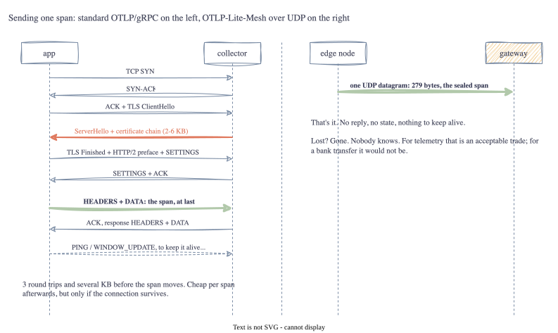

# Part 7: No Handshake: UDP Multicast on 4319

<!-- TODO(jake): opening in your own words. First time a frame leaves the process. -->

Six parts in, and not one byte has left the program. Everything so far has been a function returning
a slice of bytes to a test. This part puts a frame on a socket, which is also the part where the
spec's big claim gets tested: that you can run telemetry over a network with no connection and no
acknowledgement at all.

## Lesson 1: TCP is a conversation, UDP is a postcard



The left side is what Part 1 described: before a standard OTLP span moves, the app and collector
exchange a TCP handshake, a TLS handshake with a certificate chain, and an HTTP/2 preface. Three round
trips and several kilobytes. In exchange you get a **connection**: bytes arrive in order, lost ones
are resent, and both ends know the other is there.

The right side is a **UDP datagram**. You hand the operating system up to 1280 bytes and a destination,
and it sends them. That's the whole protocol. No reply, no sequence numbers, no retransmission. If the
datagram is lost, nobody is told. If two are sent, they may arrive in the other order, or one may
arrive twice.

For a bank transfer this would be unacceptable. For telemetry, which is sampled, approximate and
best-effort by nature, it's a trade the spec is right to make. A span is useful if it arrives and
survivable if it doesn't. What matters is that the code *knows* that, which is why the receiver counts
drops and the sealing layer tolerates reordering (the 64-frame window from Part 6 exists for exactly
this).

## Lesson 2: Multicast, or sending to nobody in particular

The spec says frames are broadcast to the mesh rather than sent to one address, because an edge node
doesn't know which peer is the gateway. UDP has a mechanism for this: **multicast groups**. An address
in the `239.0.0.0/8` range isn't a machine; it's a channel. Receivers *join* the group and the network
delivers each datagram to all of them. Senders don't know or care who's listening.

Two details that mattered:

- `239.x.x.x` is the **administratively scoped** range. Routers don't forward it beyond the local
  network, which is what a mesh wants. We use `239.42.0.1`.
- The **TTL** on a multicast datagram is how many routers it may cross. The default is 1: this link
  only.

And one that cost me an hour: **multicast doesn't loop back on macOS**. The receiver joins the group
fine, the sender sends fine, and nothing arrives, because the Mac won't deliver its own multicast
back to itself without more socket plumbing than this project needs. On Linux it works. So the
multicast test skips with an honest message on a Mac, and the rest of the tests, and the demo, use
plain unicast UDP to `127.0.0.1`. Same code path; the only difference is the address.

<!-- TODO(jake): did it loop back for you? If you're on Linux it should. -->

## Lesson 3: The 1280-byte line

A UDP datagram *can* be up to 65,507 bytes, but if it's bigger than the network's MTU, IP chops it
into fragments and reassembles them at the other end. On a lossy link that's a trap: lose any one
fragment and the whole datagram is gone, and many networks drop fragments outright. So the practical
rule is: **never send a datagram you'd need to fragment.**

1280 is the magic number because it's the minimum MTU every IPv6 link must support, and real Wi-Fi
links are 1500. That's where `DefaultMaxPayload` came from back in Part 2, and the UDP receiver
enforces it one layer down: a datagram over 1280 bytes is counted and dropped before any code looks
at it. The sender refuses to send one. Our 279-byte sealed span is comfortably inside.

## Lesson 4: Dumb transport, deliberately

The transport package knows nothing about frames. It moves bytes, counts them, enforces the size
limit, and hands each datagram to a function you give it. That function is where decoding, opening
and OTLP happen, and that's the gateway's job in Part 8. Keeping the layers apart means the transport
can be swapped (BLE one day) without touching the rest, and it means I could test the whole stack
end-to-end in one test:

> span → prune → marshal → seal → UDP → receive → open → unmarshal → equal to what was sent

That test passes on loopback with 279 bytes on the wire. The first time a span crossed a socket and
came out the other side intact, every stage so far was in the path.

## Seeing it

`meshdump` grew a `-listen` flag. In one terminal:

```
$ go run ./cmd/meshdump -listen 127.0.0.1:4319
meshdump: listening on 127.0.0.1:4319 for one datagram (timeout 30s)
```

In another, send it the demo frame with plain netcat:

```
$ go run ./cmd/meshdump -demo | nc -u -w1 127.0.0.1 4319
```

and the first terminal prints the usual field-by-field dump, with the extra line
`meshdump: 34 bytes from 127.0.0.1:52345` saying where it came from. No code of ours was involved in
sending it; `nc` just pushed bytes into a socket. That's what "no protocol below the payload" means in
practice.

<!-- TODO(jake): paste your own output here -->

## Go corner

<!-- TODO(jake): keep or cut. This is the concurrency stage; the LEARN comments in the code are
     more detailed than this list. -->

- **Goroutines.** `go func() { ... }()` starts a concurrent function. The receiver uses one to wait
  for cancellation and close the socket, which unblocks the read loop. That "close to unblock" pattern
  is how most Go network servers stop.
- **`context.Context`.** The standard way to say "stop" across goroutines. `ctx.Done()` is a channel
  that closes when the context is cancelled or times out; `<-ctx.Done()` blocks until then.
- **Channels.** Typed pipes between goroutines. The tests use one to carry datagrams from the
  receiver's goroutine to the test's; the channel does the synchronisation.
- **`select`.** Wait on several channels at once; take whichever is ready. Paired with
  `time.After`, it's the standard "wait, but not forever".
- **`sync/atomic`.** `atomic.Uint64` counters can be incremented from one goroutine and read from
  another without a lock. The stats use them.
- **Functional options.** `udp.NewReceiver(addr, udp.WithMaxFrame(300))`: a variadic list of
  functions that tweak a settings struct. Common Go idiom for optional configuration.
- **`t.Cleanup`.** Registers a function to run when a test ends, pass or fail. Used to stop the
  receiver and assert it stopped cleanly.
- **`go test -race`.** The race detector instruments every memory access and reports concurrent
  unsynchronised ones. Everything in this part was written with it on, and it stayed quiet.

## Next Steps

Frames cross the network. Part 8 builds the gateway: the thing on the far side that opens them,
rebuilds proper OTLP requests with the resource information that was stripped, and speaks gRPC to a
real backend.

[Part 8: Hydrating Back Into OTLP and gRPC →](08-gateway.html)
